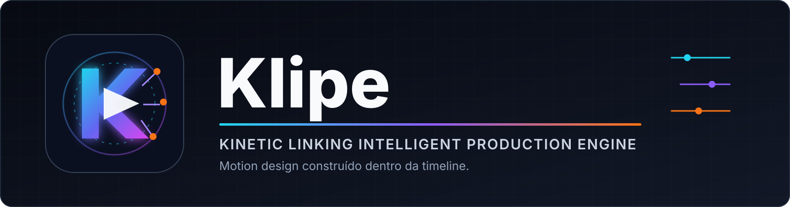

<p align="center">
  
</p>

<p align="center">
  <strong>Não é só edição. É movimento construído dentro da timeline.</strong>
</p>

<p align="center">
  
  
  
  
  <a href="LICENSE"></a>
</p>

## O Klipe

Klipe é um editor de vídeo local com timeline multipista no Desktop Windows ou no navegador e um
motor próprio de motion design em Python/Skia. Preview, composição e render
vivem no mesmo fluxo para aproximar o que você vê do arquivo final.

**Primeira vez por aqui?** Não precisa saber programar para começar a editar.
Baixe o aplicativo, instale e siga o [guia para iniciantes](docs/PRIMEIROS-PASSOS.md).
O ZIP público não inclui os vídeos e projetos particulares da demonstração.

| Quero... | Onde começar |
| --- | --- |
| Instalar no meu PC | [Instalação passo a passo](docs/INSTALACAO.md) |
| Fazer meu primeiro vídeo | [Do primeiro projeto ao MP4](docs/PRIMEIROS-PASSOS.md) |
| Entender o que mudou | [Novidades da versão](docs/NOVIDADES.md) |
| Tirar o fundo ou colocar texto atrás da pessoa | [Recorte explicado](docs/PRIMEIROS-PASSOS.md#remover-fundo-e-colocar-texto-atras-da-pessoa) |
| Resolver um problema | [Dúvidas frequentes](docs/PRIMEIROS-PASSOS.md#duvidas-frequentes) |
| Usar ajuda de um agente de código | [Edição assistida](docs/ASSISTENTE.md) |

## Novidades

- **Biblioteca de sons incluida:** 35 efeitos Woven SFX (CC0), organizados em Audio > Efeitos sonoros. Clique para ouvir ou use + para inserir na timeline; funcionam offline, sem API ou assinatura. [Origem e licenca](public/sfx/WOVEN-LICENSE.txt).
- **Atualizações pelo GitHub:** botão em Configurações para instalações Git, com proteção para alterações locais. [Como atualizar](docs/ATUALIZACOES.md).
- **FFmpeg 9.0.2:** instalador com versão fixa e checksum, render compatível e versão anterior preservada.
- **Klipe Desktop para Windows:** o editor em janela própria, com a marca oficial e atalho na área de trabalho.
- **Interface clássica:** a mesma no navegador e no aplicativo Desktop, com modos Edição/Revisão e preview em tela cheia. [Como usar](app/README.md#espaco-de-trabalho).
- **Instalação automática:** prepara as dependências, o Desktop e o módulo local de remoção de fundo.
- **Recorte em Propriedades:** modos para remover o cenário ou colocar a pessoa na frente dos títulos, com limpeza e suavidade ajustáveis.
- **Posição e escala do vídeo principal:** reenquadre cada clipe em Propriedades, sem confundir isso com um zoom animado.
- **Fechamento do Desktop corrigido:** verifica alterações sem bloquear a janela e avisa sobre edições não salvas ou render ativo.
- **Preview do recorte ajustado:** correções de sincronismo entre o vídeo e a pessoa recortada.

Veja [o que cada novidade faz e seus limites](docs/NOVIDADES.md). O Desktop usa
a pasta instalada do Klipe; ainda não é um pacote offline independente nem um
executável assinado. A versão Desktop atual é para Windows.

## Veja o Klipe em ação

https://github.com/user-attachments/assets/a23f85e0-d39c-4471-a5ef-d7ef4f518d5b

Prévia com áudio em 720p, reproduzível nesta página.


<p align="center">
  <a href="https://youtu.be/EPf02R5D8Rs"><strong>Assistir à demonstração no YouTube</strong></a> · 1 minuto · Full HD
</p>

Motion B-roll, gráficos animados, tipografia cinética, zooms, transições e
SFX: veja diferentes estilos reunidos em um vídeo editado e renderizado no
Klipe. Demonstração publicada no canal **Xang TV**.

## Desempenho na prática

**Um vídeo de 60 segundos em Full HD renderizado em 32 segundos.**

Esse foi o tempo informado pelo ForgeRender ao exportar a demonstração acima
em 11/09/2026, na máquina de desenvolvimento: 1920 × 1080, H.264 com
NVENC na GPU, áudio AAC e reaproveitamento do cache de overlays. O arquivo
final tem aproximadamente 76 MiB.

O Klipe combina composição em Skia, FFmpeg e cache para reduzir o trabalho
repetido na exportação. Nesse teste com cache, o render levou menos tempo
que a duração do próprio vídeo. Uma primeira exportação sem cache pode
levar mais tempo; hardware, resolução e complexidade da timeline também
influenciam o resultado.

Este é um resultado medido no demo, não um benchmark comparativo com React
ou Remotion. Uma comparação de velocidade exige a mesma composição,
hardware, qualidade de saída e condições de cache.

## Quatro pilares

| Pilar | No Klipe |
| --- | --- |
| **Composição** | Motion B-roll, formas, camadas, máscaras e enquadramento |
| **Tipografia** | Títulos cinéticos, legendas e presets editáveis |
| **Ritmo** | Cortes, zooms, transições e animações guiadas pela timeline |
| **SFX** | Efeitos, música, voz e mixagem no preview e no render |

## Recursos

- Timeline multipista para vídeo, Motion B-roll, títulos, legendas e áudio
- MotionCore com render em Skia e composição final por FFmpeg
- Preview local sem depender de nuvem para a edição básica
- Projetos isolados em `public/projects/<slug>`
- Salvamento manual por **Save** ou `Ctrl+S`
- Importação local e por URL, transcrição e busca opcional de B-roll
- Integrações opcionais com Veo e Omni, configuradas apenas na máquina local
- Launchers para Windows e macOS
- Remoção de fundo em **Propriedades → Vídeo → Recorte**, com pessoa à frente dos títulos
- Instalador automático para Windows, incluindo as dependências do recorte local

## Começo rápido

### Windows

1. Baixe o [ZIP do Klipe](https://github.com/neuroinovatech-lab/Klipe/archive/refs/heads/main.zip).
2. **Extraia tudo** para uma pasta permanente, por exemplo `Documentos\Klipe`.
3. Dê dois cliques em **`Instalar Klipe.bat`** e confirme com **S**.
4. Quando terminar, abra **Klipe Desktop** na área de trabalho para usar a janela
   própria, ou **Klipe** para abrir no navegador.

O instalador verifica Node.js e Python 3.11 pelo WinGet e instala FFmpeg 9.0.2
de um pacote fixo com SHA256 verificado. Prepara as dependências e o modelo de
remoção de fundo. **Não precisa
instalar Conda nem digitar comandos.** Requer Windows 10/11 de 64 bits, internet
e WinGet; a instalação do Node pode solicitar permissão do Windows.

Depois, `Iniciar Klipe.bat` abre o editor no navegador quando o servidor estiver
pronto. Se a porta 3002 estiver ocupada, escolhe outra disponível. A edição
continua local e os projetos não são apagados pelo instalador.

Veja [o guia de instalação e solução de problemas](docs/INSTALACAO.md).
Esta primeira versão é um instalador por script, não um `.exe` assinado.

### Klipe Desktop

O instalador também prepara o **Klipe Desktop para Windows**, com ícone, janela
própria e inicialização automática dos processos. Os projetos e o editor são os
mesmos; `Klipe Desktop.bat` abre a janela e `Iniciar Klipe.bat` mantém o modo web.
Confira [o guia do Desktop](app/README.md) para os detalhes e limites desta versão.

### macOS

```bash
brew install node python ffmpeg
npm install
python3 -m pip install -r requirements.txt
chmod +x "Iniciar Klipe.command"
./Iniciar\ Klipe.command
```

O núcleo do editor e o MotionCore funcionam no macOS. Integrações nativas como
NVENC, Explorer e automações do DaVinci podem exigir adaptação ao sistema.

### Execução manual

```bash
npm install
python -m pip install -r requirements.txt
npm start
```

## Primeiro projeto

O repositório começa sem vídeos nem projetos de clientes. Abra o Klipe, crie
um projeto e importe uma mídia. Cada projeto recebe seu próprio
`edit_config.json` e pode ser acessado em `/p/<slug>`.

1. Clique em **Novo** e dê um nome simples, como `meu-primeiro-video`.
2. Escolha seu vídeo principal e clique em **Criar**.
3. Dê **Play**, selecione um clipe na timeline e veja seus controles em **Propriedades**.
4. Adicione textos e efeitos, confira o resultado e clique em **Save**.
5. Para gerar o vídeo final, abra **Render**, escolha o destino e use **Iniciar Render**.

**Save guarda a edição; Render cria o arquivo de vídeo.** Um MP4 não substitui
a pasta do projeto editável. O [guia de primeiros passos](docs/PRIMEIROS-PASSOS.md)
explica cada etapa, o recorte e como levar o projeto para outro computador.

## Arquitetura

```text
editor.html              interface, preview e estado da timeline
editor-server.js         servidor local, projetos e processos de render
motioncore/              composição e animação em Python/Skia
forge_render.py          render final e mixagem com FFmpeg
public/klipe_player.js   player do preview
public/projects/         projetos locais ignorados pelo Git
```

Veja [docs/ARCHITECTURE.md](docs/ARCHITECTURE.md) para o fluxo completo.

## Configuração

Copie somente as variáveis necessárias de `.env.example` para o seu ambiente.
Chaves e configurações locais também podem ser definidas pela interface e são
armazenadas fora do Git.

## Desenvolvimento

```bash
npm run check
python -m compileall -q motioncore
```

Pull requests passam por uma checagem automática de sintaxe e JSON. Consulte
[CONTRIBUTING.md](CONTRIBUTING.md) antes de alterar contratos da timeline ou do
render.

## Privacidade

Vídeos, áudios, renders, bancos, chaves, fontes de terceiros e projetos de
trabalho são ignorados pelo Git. Antes de publicar qualquer mídia, confirme os
direitos de uso do conteúdo e das pessoas que aparecem nele.

## Licença

**Grátis para usar, inclusive em trabalhos pagos.** Você pode baixar e instalar
o Klipe no seu computador, editar vídeos para clientes, cobrar pela edição e
monetizar os conteúdos produzidos. Não há cobrança de royalties do Klipe sobre
esses vídeos.

Você também pode estudar o código, adaptá-lo para uso próprio ou interno e
contribuir por forks gratuitos no GitHub, preservando a licença e a autoria.

**Não é permitido vender o Klipe ou versões modificadas, cobrar pelo acesso ao
software ou incorporá-lo a outro software comercializado sem autorização por
escrito.** Compartilhar o link oficial é permitido; outras formas de
redistribuição seguem as condições da licença.

Esta é uma licença própria de uso gratuito com restrições, não uma licença MIT
ou open source. Componentes e mídias de terceiros mantêm suas próprias licenças.
Consulte os termos completos em [LICENSE](LICENSE).
